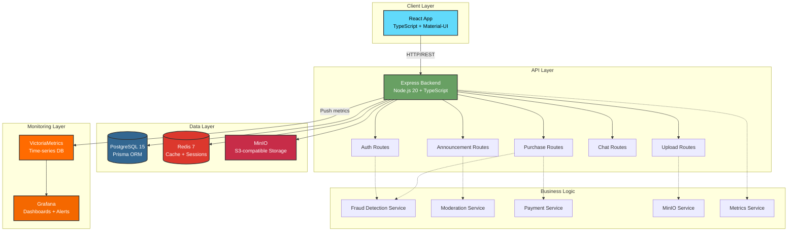
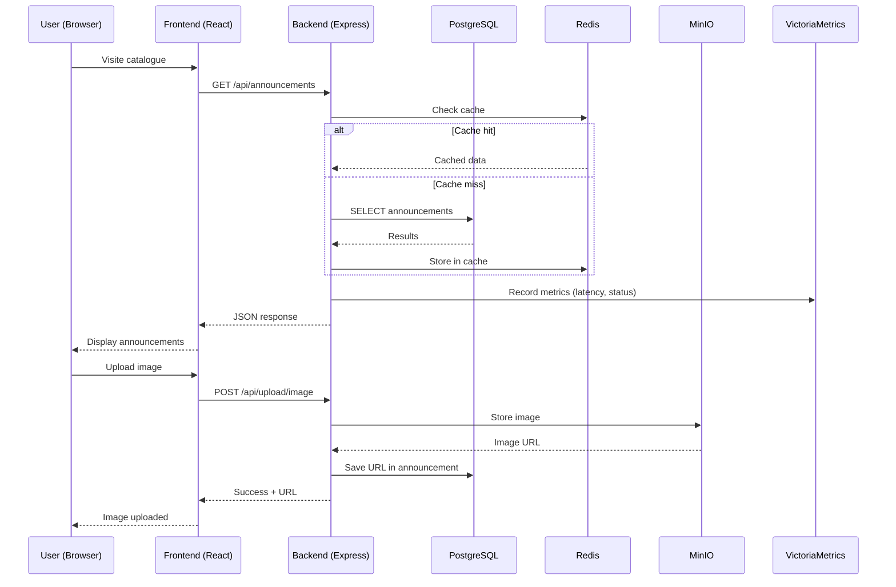
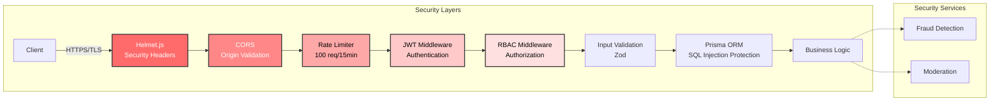
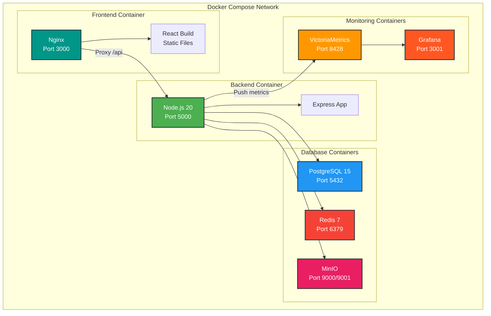
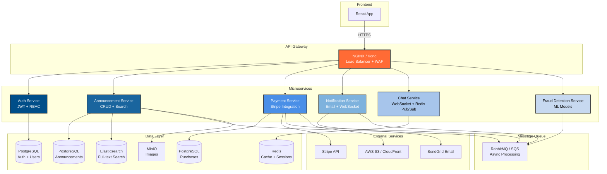
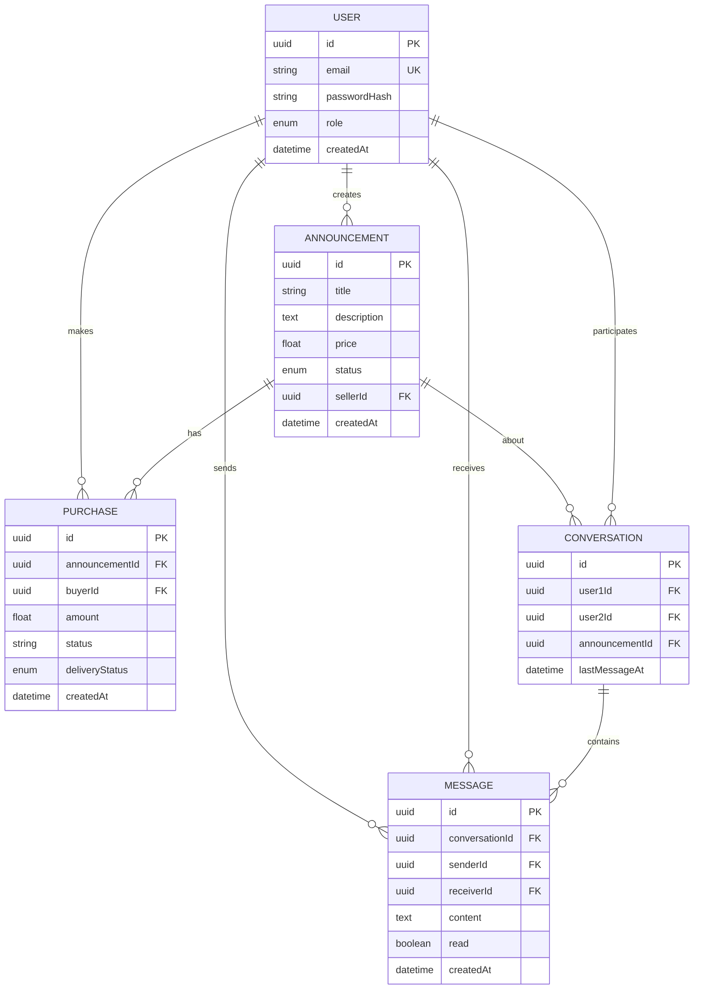
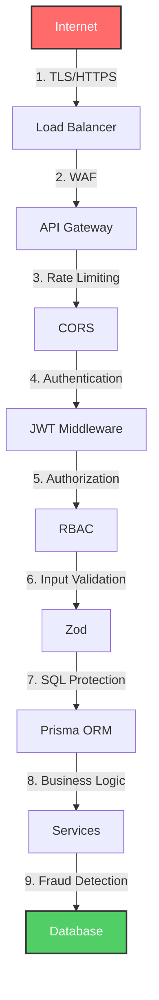

# Architecture Technique — Collector.shop

## 📐 Vue d'ensemble

Collector.shop est une application web full-stack containerisée suivant une architecture **monolithique modulaire** avec une vision **microservices** pour la V2.

---

## 🏗️ Architecture V1 (POC actuel)

### Diagramme global

### Flux de données

---

## 🔐 Architecture de sécurité

---

## 📦 Architecture de déploiement (Docker Compose)

---

## 🚀 Architecture V2 (Vision microservices)

### Diagramme cible

### Stratégie de migration V1 → V2

```mermaid
graph LR
    A[V1 Monolithe] -->|Phase 1| B[Extract Auth Service]
    B -->|Phase 2| C[Extract Payment Service]
    C -->|Phase 3| D[Extract Notification Service]
    D -->|Phase 4| E[Extract Chat Service]
    E -->|Phase 5| F[Full Microservices]
    
    style A fill:#ffd93d,stroke:#333,stroke-width:2px,color:#000
    style F fill:#6bcf7f,stroke:#333,stroke-width:2px,color:#fff
```

**Critères de migration** :
1. Trafic > 10k utilisateurs actifs/jour
2. Équipe ≥ 5 développeurs
3. Budget infrastructure disponible
4. Besoin de scaling indépendant des services

---

## 🔄 Pipeline CI/CD

```mermaid
graph LR
    A[Git Push] --> B[GitHub Actions]
    B --> C[Build & Lint]
    C --> D[Unit Tests]
    D --> E[Integration Tests]
    E --> F[Security Scan<br/>Snyk + Trivy]
    F --> G[Code Analysis<br/>SonarQube]
    G --> H[Build Docker Images]
    H --> I[Push to GHCR]
    I --> J[Deploy Staging]
    J --> K[Smoke Tests]
    K --> L[Deploy Production]
    
    style A fill:#24292e,stroke:#333,stroke-width:2px,color:#fff
    style F fill:#ff6b6b,stroke:#333,stroke-width:2px,color:#fff
    style L fill:#51cf66,stroke:#333,stroke-width:2px,color:#fff
```

---

## 📊 Modèle de données

---

## 🎯 Principes architecturaux

### 1. Séparation des concerns

- **Frontend** : Présentation + UX (React)
- **Backend** : Business logic + API (Express)
- **Data** : Persistance + Cache (PostgreSQL + Redis)
- **Monitoring** : Observabilité (VictoriaMetrics + Grafana)

### 2. Scalabilité

**Horizontal** :
- Backend stateless (JWT, pas de sessions en mémoire)
- Load balancer NGINX (V2)
- PostgreSQL avec read replicas (V2)

**Vertical** :
- Indexes Prisma sur colonnes fréquentes
- Pagination (20 items/page)
- Cache Redis pour requêtes coûteuses

### 3. Résilience

- Health checks sur tous les services
- Retry avec backoff exponentiel (V2)
- Circuit breakers (V2)
- Graceful shutdown (SIGTERM)

### 4. Sécurité (Defense in Depth)

1. **Périmètre** : HTTPS, CORS, Rate limiting
2. **Application** : JWT, RBAC, Input validation
3. **Données** : Bcrypt, Prisma ORM, TDE (V2)
4. **Monitoring** : Logs, métriques, alertes

### 5. Observabilité

- **Logs** : Winston (JSON structuré)
- **Métriques** : Prometheus/VictoriaMetrics
- **Traces** : OpenTelemetry (V2)
- **Dashboards** : Grafana

---

## 🔧 Choix techniques justifiés

| Composant | Choix | Alternative | Justification |
|-----------|-------|-------------|---------------|
| **Frontend** | React 18 | Vue.js, Angular | Écosystème riche, Material-UI, équipe familière |
| **Backend** | Express.js | NestJS, Fastify | Simplicité, flexibilité, maturité |
| **ORM** | Prisma | TypeORM | Type-safety, DX, performance (voir POC_PRISMA.md) |
| **Database** | PostgreSQL | MySQL, MongoDB | ACID, JSON, full-text search, maturité |
| **Cache** | Redis | Memcached | Structures de données riches, pub/sub |
| **Storage** | MinIO | AWS S3 | S3-compatible, self-hosted, coût |
| **Monitoring** | VictoriaMetrics | Prometheus | Performance, compression, API compatible |
| **Containerisation** | Docker | Podman | Standard industrie, écosystème |

---

## 📈 Capacité et limites

### Capacité actuelle (V1)

- **Utilisateurs simultanés** : ~150 (testé avec Artillery)
- **Requêtes/seconde** : ~120 RPS
- **Latence P95** : 180ms
- **Stockage images** : Limité par disque MinIO (extensible)

### Goulots d'étranglement identifiés

1. **Backend monolithique** : Un seul process Node.js
   - **Solution V2** : Load balancer + multi-instances

2. **PostgreSQL single-instance** : Pas de read replicas
   - **Solution V2** : PostgreSQL cluster (master + replicas)

3. **Pas de CDN** : Images servies directement depuis MinIO
   - **Solution V2** : CloudFront ou Cloudflare

4. **Uploads synchrones** : Bloquent le thread principal
   - **Solution V2** : Queue (RabbitMQ) + workers

### Stratégie de scaling

**0-1k utilisateurs** : Architecture actuelle suffisante  
**1k-10k utilisateurs** : Load balancer + multi-instances backend  
**10k-100k utilisateurs** : Microservices + PostgreSQL cluster + CDN  
**100k+ utilisateurs** : Kubernetes + auto-scaling + multi-région

---

## 🛡️ Sécurité en profondeur

### Couches de protection

---

## 📚 Documentation complémentaire

- **Installation** : `/docs/INSTALLATION.md`
- **Monitoring** : `/docs/MONITORING.md`
- **POC Prisma** : `/docs/POC_PRISMA.md`
- **Sécurité** : `/SECURITY.md`
- **README** : `/README.md` (documentation principale)

---

## 🎓 Pour le jury

Cette architecture démontre :

1. **Pragmatisme** : Monolithe modulaire adapté au POC, avec vision microservices
2. **Scalabilité** : Architecture pensée pour évoluer (load balancer, cache, queue)
3. **Sécurité** : Defense in Depth avec 9 couches de protection
4. **Observabilité** : Monitoring complet (logs, métriques, dashboards)
5. **Maintenabilité** : Séparation des concerns, code modulaire, tests automatisés

**Points forts** :
- Architecture défendable devant experts
- Choix techniques justifiés (voir POC_PRISMA.md)
- Vision claire V1 → V2
- Pas d'over-engineering

**Améliorations V2** :
- Microservices (quand justifié par le trafic)
- Kubernetes (orchestration)
- Service mesh (Istio)
- Multi-région (haute disponibilité)

---

*Document rédigé le 31 janvier 2026*  
*Version : 1.0*  
*Auteur : Lead Developer - Collector.shop*
