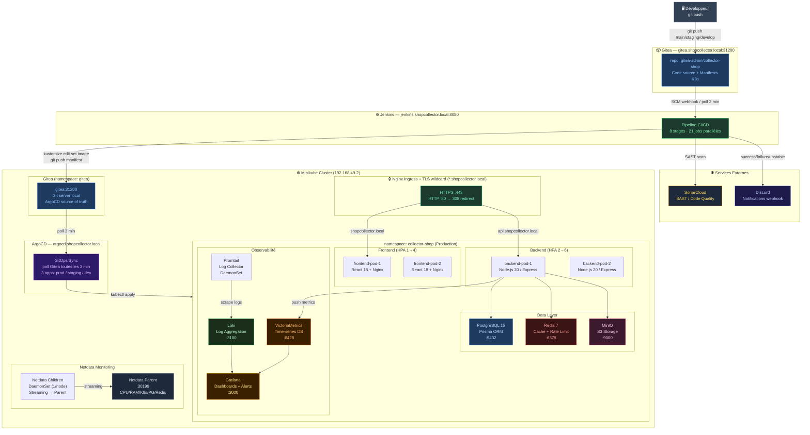
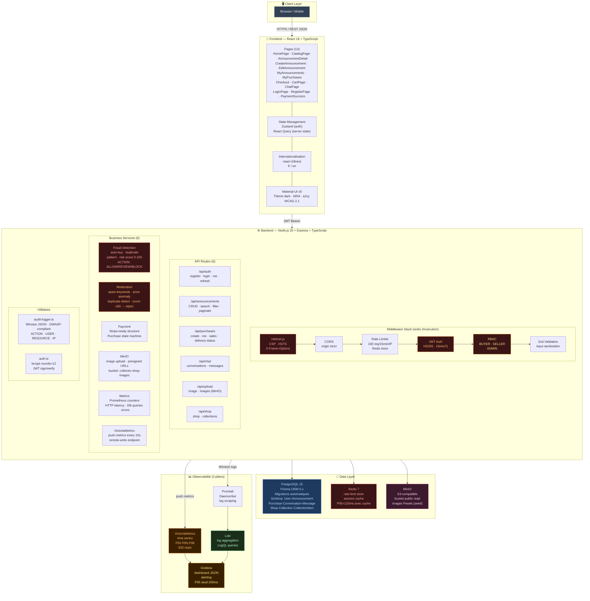
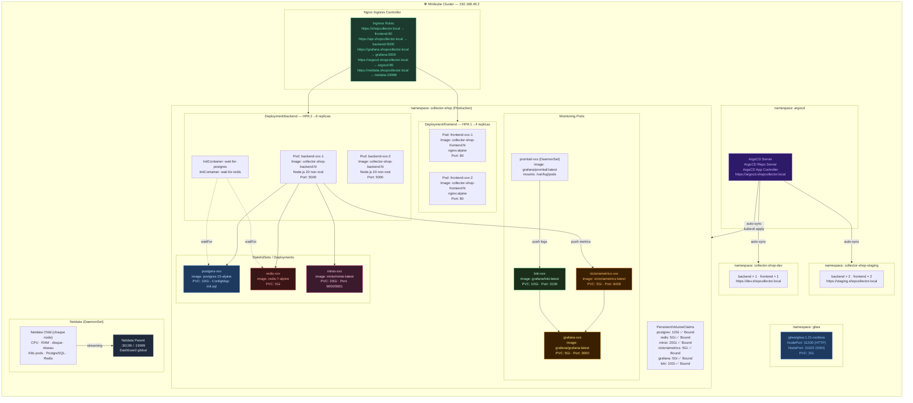
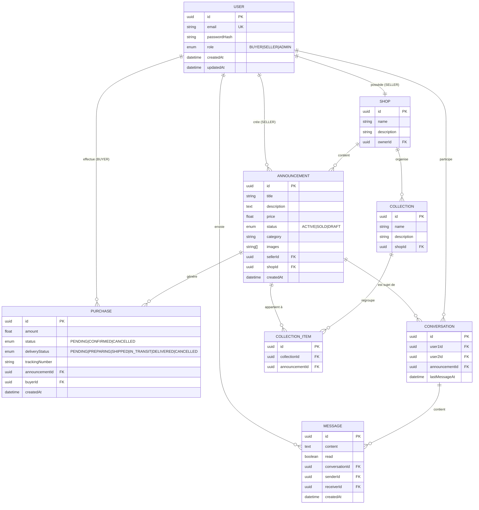
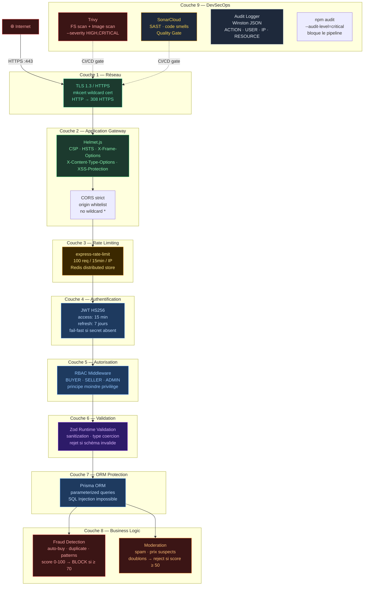
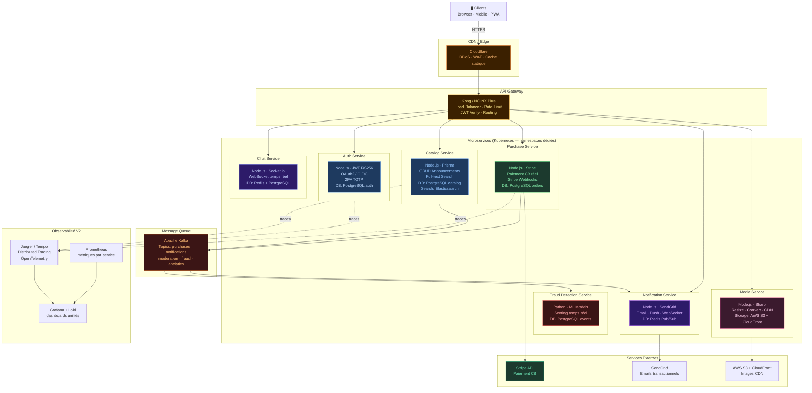

# Architecture Technique — Collector.shop

**Date** : 18 mars 2026
**Projet** : Collector.shop — Marketplace de cartes Pokémon rares
**Stack** : TypeScript fullstack · Kubernetes · Jenkins CI/CD · ArgoCD GitOps

---

## 1. INFRASTRUCTURE GLOBALE (Vue bout en bout)

---

## 2. PIPELINE CI/CD JENKINS (8 stages en parallèle)

```mermaid
graph TB
    START(["🚀 git push\nmain / staging / develop"])

    START --> S1

    subgraph S1["Stage 1 — Checkout & Installation"]
        direction LR
        S1A["checkout scm"]
        S1B["npm install (workspaces)"]
        S1C["prisma generate"]
        S1A --> S1B --> S1C
    end

    S1 --> S2

    subgraph S2["Stage 2 — Lint → Qualité → Compilation (PARALLÈLE)"]
        direction LR
        S2A["Lint Backend\nESLint TypeScript"]
        S2B["Lint Frontend\nESLint React/TSX"]
        S2C["Qualité npm\nnpm audit + license-checker"]
        S2D["SonarCloud\nSAST · Code Smells · Coverage"]
        S2E["Compilation Backend\ntsc"]
        S2F["Compilation Frontend\ntsc + vite build"]
    end

    S2 --> S3

    subgraph S3["Stage 3 — Tests Unitaires (PARALLÈLE)"]
        direction LR
        subgraph BACKEND_TRACK["Branche A — Backend"]
            S3A1["Démarrage PostgreSQL\néphémère :15432\nprisma db push"]
            S3A2["Jest Backend\n18 tests · 82% coverage\nJUnit XML + HTML"]
            S3A1 --> S3A2
        end
        subgraph FRONTEND_TRACK["Branche B — Frontend"]
            S3B1["Jest Frontend\n2 tests · jsdom\nJUnit XML + HTML"]
        end
    end

    S3 --> S4

    subgraph S4["Stage 4 — Analyse Sécurité (PARALLÈLE)"]
        direction LR
        S4A["Trivy Filesystem\nvuln + secret scan\n--severity HIGH,CRITICAL"]
        S4B["npm audit strict\n--audit-level=critical"]
    end

    S4 --> S5

    subgraph S5["Stage 5 — Build Docker (PARALLÈLE)"]
        direction LR
        S5A["Build Backend\ndocker build\n-f backend/Dockerfile"]
        S5B["Build Frontend\ndocker build\n-f frontend/Dockerfile"]
        S5C["Scan Trivy Images\nbackend + frontend"]
        S5D["Load → Minikube\ndocker save | docker load\n--tls minikube daemon"]
        S5A --> S5C
        S5B --> S5C
        S5C --> S5D
    end

    S5 --> S6

    subgraph S6["Stage 6 — ArgoCD GitOps"]
        direction LR
        S6A["kustomize edit set image\nBUILD_NUMBER tag"]
        S6B["git push → Gitea\nmanifest branch"]
        S6C["REST API ArgoCD sync\nPolling Synced+Healthy\nmax 5 min"]
        S6A --> S6B --> S6C
    end

    S6 --> S7

    subgraph S7["Stage 7 — Tests de Charge & Intégration (PARALLÈLE)"]
        direction LR
        S7A["Smoke Tests\ncurl health · api · frontend\nattente services live"]
        S7B["Artillery Load Tests\nP95 < 500ms\nerror rate < 5%\nrapport HTML archivé"]
    end

    S7 --> S8

    subgraph S8["Post — Notifications Discord"]
        direction LR
        S8A["SUCCESS\nvert + liens app/grafana/argocd"]
        S8B["FAILURE\nrouge + lien logs Jenkins"]
        S8C["UNSTABLE\njaune + métriques"]
    end

    S8POST(["🏁 Fin + cleanWs\ndocker rm postgres"])
    S8 --> S8POST

    style START fill:#1c3a2e,stroke:#22c55e,color:#86efac
    style S2A fill:#1e3a5f,stroke:#3b82f6,color:#93c5fd
    style S2B fill:#1e3a5f,stroke:#3b82f6,color:#93c5fd
    style S2D fill:#1e293b,stroke:#f59e0b,color:#fcd34d
    style S3A2 fill:#1c3a2e,stroke:#22c55e,color:#86efac
    style S3B1 fill:#1c3a2e,stroke:#22c55e,color:#86efac
    style S4A fill:#3b1515,stroke:#ef4444,color:#fca5a5
    style S4B fill:#3b1515,stroke:#ef4444,color:#fca5a5
    style S5C fill:#3b1515,stroke:#f97316,color:#fdba74
    style S6C fill:#2d1b69,stroke:#a855f7,color:#d8b4fe
    style S8A fill:#1c3a2e,stroke:#22c55e,color:#86efac
    style S8B fill:#3b1515,stroke:#ef4444,color:#fca5a5
    style S8C fill:#3b2800,stroke:#f59e0b,color:#fde68a
```

---

## 3. STACK APPLICATIF V1 (Monolithe modulaire)

---

## 4. KUBERNETES — NAMESPACES ET PODS

---

## 5. FLUX GITOPS — DE GIT PUSH À KUBERNETES

```mermaid
sequenceDiagram
    actor DEV as Développeur
    participant GITEA as Gitea (local Git)
    participant JENKINS as Jenkins CI
    participant SONAR as SonarCloud
    participant MINIK as Minikube Docker
    participant ARGO as ArgoCD
    participant K8S as Kubernetes

    DEV->>GITEA: git push (main)
    GITEA-->>JENKINS: SCM webhook / poll 2min

    rect rgb(28, 58, 46)
        note over JENKINS: Stage 2 — Lint + Qualité (parallèle)
        JENKINS->>SONAR: npx sonarqube-scanner
        SONAR-->>JENKINS: Quality Gate result
    end

    rect rgb(28, 58, 46)
        note over JENKINS: Stage 3 — Tests (parallèle)
        JENKINS->>JENKINS: PostgreSQL éphémère :15432
        JENKINS->>JENKINS: Jest Backend (18 tests)
        JENKINS->>JENKINS: Jest Frontend (2 tests)
    end

    rect rgb(59, 21, 21)
        note over JENKINS: Stage 4 — Sécurité (parallèle)
        JENKINS->>JENKINS: Trivy FS scan
        JENKINS->>JENKINS: npm audit --critical
    end

    rect rgb(28, 58, 46)
        note over JENKINS: Stage 5 — Build Docker (parallèle)
        JENKINS->>MINIK: docker build backend:BUILD_NUMBER
        JENKINS->>MINIK: docker build frontend:BUILD_NUMBER
        JENKINS->>JENKINS: Trivy image scan
        JENKINS->>MINIK: docker save | docker load (TLS)
    end

    rect rgb(45, 27, 105)
        note over JENKINS: Stage 6 — GitOps
        JENKINS->>GITEA: kustomize edit set image :BUILD_NUMBER
        JENKINS->>GITEA: git push manifest (kustomization.yaml)
        GITEA-->>ARGO: poll 3 min → détecte changement tag
        ARGO->>K8S: kubectl apply (rolling update)
        K8S-->>ARGO: Synced + Healthy ✅
        ARGO-->>JENKINS: REST API status
    end

    rect rgb(28, 58, 46)
        note over JENKINS: Stage 7 — Tests post-déploiement
        JENKINS->>K8S: curl health checks (smoke tests)
        JENKINS->>K8S: Artillery load tests (P95 < 500ms)
    end

    JENKINS->>DEV: Discord notification (success/failure/unstable)
```

---

## 6. MODÈLE DE DONNÉES (ERD)

---

## 7. SÉCURITÉ — COUCHES DE PROTECTION (Defense in Depth)

---

## 8. ARCHITECTURE V2 — VISION MICROSERVICES

---

## 9. STRATÉGIE MIGRATION V1 → V2

```mermaid
graph LR
    V1["V1\nMonolithe Modulaire\n(actuel)\nDocker Compose\n7 services"]

    P1["Phase 1\nExtraire Auth Service\nJWT RS256 · OAuth2 · 2FA\n+ Kubernetes prod"]

    P2["Phase 2\nExtraire Payment Service\nStripe réel · webhooks\n+ Kafka messaging"]

    P3["Phase 3\nExtraire Catalog + Search\nElasticsearch full-text\n+ CDN Cloudflare"]

    P4["Phase 4\nExtraire Notification + Chat\nWebSocket · Redis Pub/Sub\n+ Jaeger tracing"]

    P5["Phase 5\nFraud Detection ML\nPython · modèles ML\n+ WAF Kong"]

    V2["V2\nMicroservices Complets\nKubernetes multi-node\nIstio Service Mesh\nAWS EKS"]

    V1 -->|"0→1k users\n2 devs\nM0-M3"| P1
    P1 -->|"1k→5k users\n3 devs\nM3-M6"| P2
    P2 -->|"5k→10k users\n4 devs\nM6-M9"| P3
    P3 -->|"10k→50k users\n5 devs\nM9-M12"| P4
    P4 -->|"50k→100k users\n6 devs\nM12-M18"| P5
    P5 -->|"100k+ users\nequipe DevOps\nM18+"| V2

    style V1 fill:#3b2800,stroke:#f59e0b,color:#fde68a
    style P1 fill:#1e3a5f,stroke:#3b82f6,color:#93c5fd
    style P2 fill:#1e3a5f,stroke:#60a5fa,color:#bfdbfe
    style P3 fill:#1c3a2e,stroke:#22c55e,color:#86efac
    style P4 fill:#2d1b69,stroke:#a855f7,color:#d8b4fe
    style P5 fill:#3b1515,stroke:#ef4444,color:#fca5a5
    style V2 fill:#1c3a2e,stroke:#10b981,color:#6ee7b7
```

---

## Récapitulatif des choix techniques

| Composant | Choix V1 | Alternative écartée | Justification |
|-----------|----------|---------------------|---------------|
| **Frontend** | React 18 + MUI | Vue.js, Angular | Écosystème, Material-UI a11y, équipe |
| **Backend** | Express.js + TypeScript | NestJS, Fastify | Simplicité, flexibilité, maturité |
| **ORM** | Prisma 5 | TypeORM | Type-safety, DX, +13% perf (POC) |
| **DB principale** | PostgreSQL 15 | MySQL, MongoDB | ACID, JSON, full-text, maturité |
| **Cache** | Redis 7 | Memcached | Rich data structures, pub/sub |
| **Storage** | MinIO | AWS S3 | S3-compatible, self-hosted, 0€ |
| **Monitoring métriques** | VictoriaMetrics | Prometheus | Performance, compression, API compat. |
| **Monitoring logs** | Loki + Promtail | ELK Stack | Léger, Kubernetes-native, Grafana compat. |
| **System monitoring** | Netdata | Datadog, Zabbix | 100% local, 0 API key, granularité 1s |
| **CI/CD** | Jenkins local | GitLab CI | Infrastructure locale, démo sans internet |
| **GitOps CD** | ArgoCD | Flux | Interface web, multi-app, RBAC |
| **Git local** | Gitea | Gogs, GitLab | Léger, ArgoCD natif, webhooks |
| **Conteneurs** | Docker | Podman | Standard industrie, compose |
| **Orchestration** | Kubernetes + Minikube | Docker Swarm | Standard industrie, HPA, GitOps |

---

*Architecture mise à jour le 18 mars 2026*
*Version : 2.0 — Collector.shop — MOUYAHADA Ismail*
